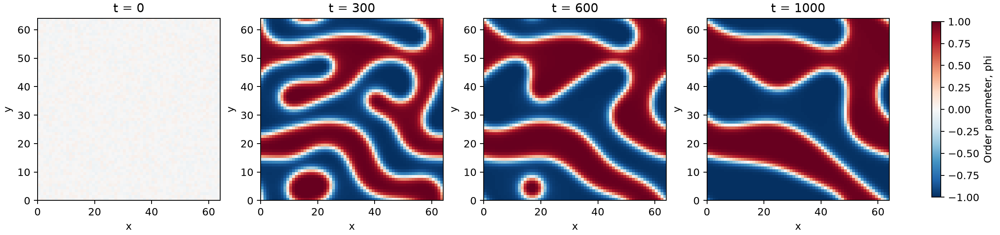

# Phase separation

A Python simulation of spinodal decomposition in a two-dimensional binary mixture. An initially mixed composition separates into domains through Cahn–Hilliard diffusion.

[中文说明](README.zh-CN.md)



The figure shows the default run: a 64 × 64 grid, seed 7, dt = 0.5, and 2000 steps. Red and blue indicate the two composition-rich phases.

## Run

Requires Python 3.11 or later.

```sh
python -m pip install -e .
phase-separation --output run --steps 2000
```

On Windows, `py` can be used instead of `python`. The output folder contains:

- `phase-separation.png`: four composition snapshots.
- `diagnostics.png`: free energy and mean composition drift.
- `fields.npz`: saved composition arrays, times and grid spacing.
- `diagnostics.csv`: energy, mass, extrema and variance at each saved time.
- `config.json` and `report.json`: run parameters and numerical diagnostics.

Choose a fresh output directory for each run. Existing results are not overwritten.

For an off-critical mixture:

```sh
phase-separation --mean 0.3 --seed 12 --steps 4000 --output off-critical
```

## More examples

Run the composition cases and time-step comparison together:

```sh
python run_cases.py --output case-runs
```

See the [case guide](examples/CASES.md) for parameters and results.

## Governing equations

All quantities are dimensionless. The conserved order parameter phi follows

```text
∂phi/∂t = M ∇²mu
mu = phi³ - phi - kappa ∇²phi
F = ∫ [(phi² - 1)²/4 + kappa |∇phi|²/2] dA
```

The two minima of the bulk free energy are at phi = -1 and +1. Mobility M is constant. Boundaries are periodic in both directions. There is no fluid flow, heat transport, nucleation model or material-specific equation of state.

The solver uses a Fourier grid with a stabilized semi-implicit time step:

```text
phi_hat_new = [phi_hat + dt M k² (S phi_hat - FFT(phi³-phi))]
              / [1 + dt M k² (S + kappa k²)]
```

The zero Fourier mode is unchanged by the update, conserving mean composition to floating-point accuracy. The cubic term is evaluated directly on the grid without dealiasing. S defaults to 2. Large time steps or extreme initial compositions can still produce inaccurate or unstable results; check energy, extrema and time-step sensitivity. The code does not clip phi or force energy to decrease.

## Parameters

| Option | Default | Meaning |
|---|---:|---|
| `--n` | 64 | Number of grid points in each direction, even integer |
| `--length` | 64 | Domain side length |
| `--dt` | 0.5 | Time step |
| `--steps` | 2000 | Number of steps |
| `--every` | 200 | Snapshot interval in steps |
| `--mean` | 0 | Conserved mean composition |
| `--noise` | 0.05 | Initial uniform perturbation amplitude |
| `--seed` | 7 | Random seed |
| `--mobility` | 1 | Constant mobility M |
| `--kappa` | 1 | Gradient energy coefficient |
| `--stabilization` | 2 | Numerical stabilization S |

## Tests

```sh
python -m unittest discover -s tests -v
```

Tests cover a stationary uniform state, mass conservation, energy decrease for a fixed test case, the amplification of a small Fourier mode, the uniform-state energy and reproducible initialization. The mode test checks the discrete update against its linearized amplification factor; it is not a time-convergence study. Report diagnostics compare saved samples, so they can miss energy increases between snapshots. For step-by-step diagnostics use `--every 1` on a short run.

For quantitative work, refine the grid at fixed physical domain length, reduce dt and compare domain statistics. The default run is a demonstration of the model rather than a calibrated prediction for a particular material.

## Contributing

Bug reports should include the command, Python/NumPy versions and a small input or seed. Numerical changes should include an independent expected result and relevant tests. Contributions are licensed under MIT; see [LICENSE](LICENSE).

## Reference

J. W. Cahn and J. E. Hilliard, “Free Energy of a Nonuniform System. I. Interfacial Free Energy,” *J. Chem. Phys.* 28, 258–267 (1958). [doi:10.1063/1.1744102](https://doi.org/10.1063/1.1744102). This is background for the gradient free-energy model, rather than a source for the time-stepping implementation.
