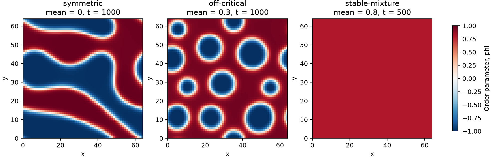
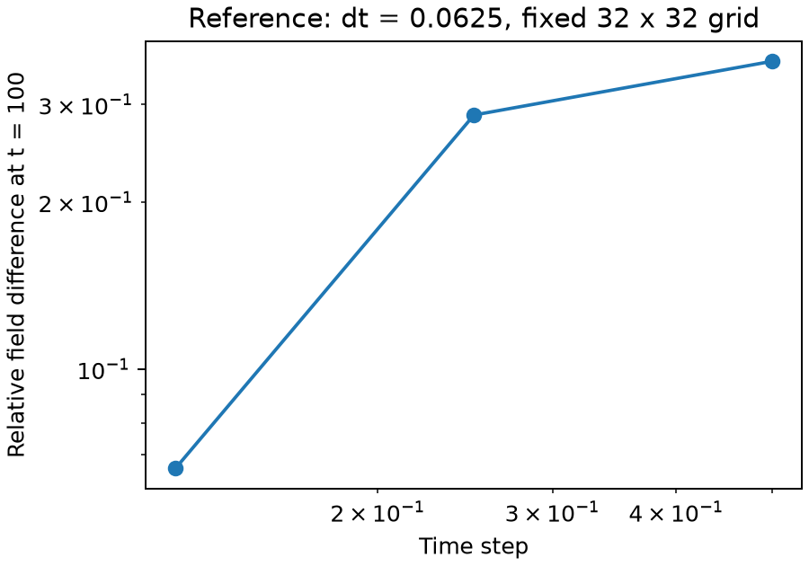

# Composition cases and time-step sensitivity

From the repository root:

```sh
python run_cases.py --output case-runs
```

This runs seven simulations and writes fields, parameters, diagnostics and figures for each. Existing output is not overwritten. The checked-in results are in `cases/`, produced with Python 3.14 and NumPy 2.5.4. All runs use seed 7, noise amplitude 0.05, M = 1, kappa = 1 and stabilization S = 2.

## Composition



These cases use a 64 × 64 periodic grid on a domain of side 64 and dt = 0.5. They illustrate morphology; they are not time-step-converged predictions.

| Case | Mean | Final time | Initial → final energy | Final variance |
|---|---:|---:|---:|---:|
| symmetric | 0 | 1000 | 1033.39 → 274.70 | 0.79375 |
| off-critical | 0.3 | 1000 | 857.82 → 399.29 | 0.58744 |
| stable-mixture | 0.8 | 500 | 145.36 → 132.71 | 1.46e-10 |

The symmetric mixture develops connected domains. At mean 0.3, the minority phase forms separated regions. At mean 0.8, the small initial perturbations decay. For the chosen bulk energy, `f''(phi)=3*phi²-1`; the mean-0.8 state is linearly stable to small perturbations. This does not establish global thermodynamic stability or exclude nucleation under other initial conditions.

Maximum mean-composition drift across these runs is below 8e-16. No energy increases were observed at saved times, spaced 50 time units apart.

## Time step



The comparison holds the grid (32 × 32), domain length (32), initial field, stabilization and final time (100) fixed. Steps are adjusted to reach the same time. The reference uses dt = 0.0625 on the same spatial grid.

| dt | Steps | Relative L2 field difference from reference | Final energy |
|---|---:|---:|---:|
| 0.5 | 200 | 35.89% | 159.5847 |
| 0.25 | 400 | 28.71% | 157.7613 |
| 0.125 | 800 | 6.62% | 156.5971 |
| 0.0625 | 1600 | reference | 155.9299 |

The differences decrease with smaller time steps, but are substantial at dt = 0.5. Mass conservation and decreasing energy alone do not establish accurate dynamics. The smallest step is a numerical reference, not an exact solution. A finer time reference and spatial refinement are needed before claiming convergence or an observed order of accuracy. Energy checks here use saved samples at intervals of 10 time units.

All values above come from `cases/summary.json`; individual runs retain CSV diagnostics and NPZ fields.

## 中文说明

三个组分案例分别展示对称混合物的连通畴、非对称混合物的少数相分散区域，以及线性稳定组分附近的小扰动衰减。这里的“stable-mixture”指本次小扰动下的线性稳定性，不等于全局热力学稳定。

时间步案例固定网格、初值、域尺寸与终止时间，只改变 dt。相对于 dt=0.0625 的同网格参考，dt=0.5 的场差异约为 35.89%，dt=0.125 时约为 6.62%。因此默认参数可用于形态演示，定量动力学研究仍需时间步和空间收敛检查。所有原始场数据、参数和诊断结果均保存在各案例目录中。
